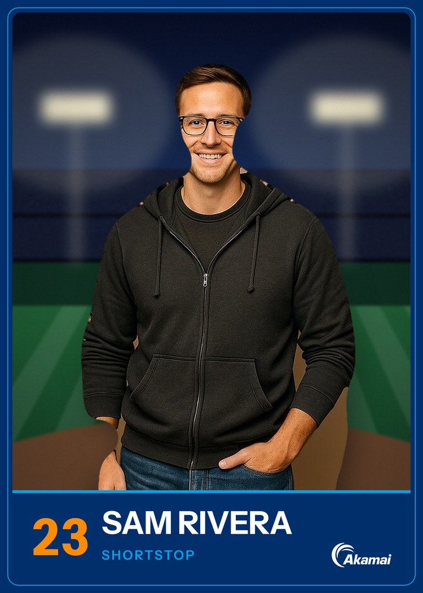
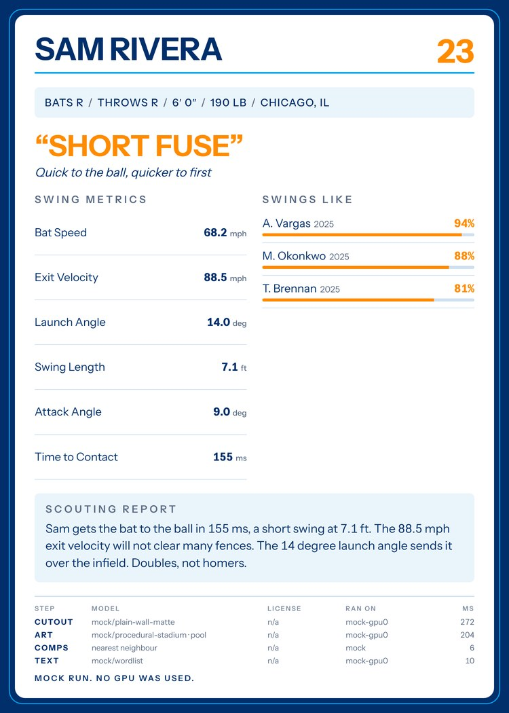

# baseball-card

You give it a headshot and a name. Three open-weight models on one Akamai Cloud
GPU node make you a baseball card, front and back. Nothing is sent to any other
service.

<p>
  
  
</p>

That is the test photo's card, drawn by `make card-fixture` with stand-ins for
the models. The matte is a colour threshold, and it bit into the right cheek.
The stadium is drawn with numpy, and the comps and the words are samples. The
back says so on its last line.

BiRefNet cuts you out of the photo, FLUX.2 [klein] paints a stadium behind you,
and Gemma 4 writes your nickname and a scouting report from the facts you gave.
The back of the card lists which model ran each step, under which licence, on
which GPU, in how many milliseconds.

## status

This repo is being built, and this README says what works today.

| Part | State |
|---|---|
| The key, the gateway, `/livez`, `/healthz`, `/models` | built, tested in mock mode |
| A stand-in for vLLM with the same routes and key check | built, tested in mock mode |
| The card, front and back, in two styles | built, drawn on a laptop with stand-ins for the models |
| The pipeline, the comps, `cardctl` | not built yet |
| BiRefNet, FLUX.2 [klein] and Gemma 4 in their services | not built yet |
| The browser app | not built yet |
| The deploy to Akamai Cloud | not built yet |

## models

| Step | Model | Licence |
|---|---|---|
| cutout | [`ZhengPeng7/BiRefNet`](https://huggingface.co/ZhengPeng7/BiRefNet) | MIT |
| art | [`black-forest-labs/FLUX.2-klein-4B`](https://huggingface.co/black-forest-labs/FLUX.2-klein-4B) | Apache 2.0 |
| text | [`google/gemma-4-12B-it-qat-w4a16-ct`](https://huggingface.co/google/gemma-4-12B-it-qat-w4a16-ct) on vLLM | Apache 2.0 |

`deploy/models.env` pins each one to a commit.

## quick start

Mock mode runs every service in Docker with stand-ins for the models. No GPU,
no cloud account. It needs Docker with Compose 2.24 or newer, `make`, `curl`,
`openssl` and [`uv`](https://docs.astral.sh/uv/).

```bash
git clone https://github.com/akamai-developers/demo--baseball-card.git
cd demo--baseball-card
make up-mock      # writes .env with a new key, builds, serves localhost:8443
```

If your user needs `sudo` for Docker, say so once per command:
`DOCKER="sudo -E docker" make up-mock`. If port 8443 is taken, set
`GATEWAY_PORT` in `.env`.

`/livez` is the one route open without the key:

```bash
curl -s -w '\n' http://localhost:8443/livez                               # ok
curl -s -o /dev/null -w '%{http_code}\n' http://localhost:8443/healthz   # 401
```

Everything else wants the key from `.env`:

```bash
export CARD_API_KEY=$(grep '^CARD_API_KEY=' .env | cut -d= -f2)
curl -s -w '\n' -H "Authorization: Bearer $CARD_API_KEY" http://localhost:8443/healthz
curl -s -w '\n' -H "Authorization: Bearer $CARD_API_KEY" http://localhost:8443/models
curl -s -w '\n' -H "Authorization: Bearer $CARD_API_KEY" http://localhost:8443/v1/models
```

`/healthz` lists each model service as it describes itself. In mock mode the
text model is `mock/wordlist`, which picks words from lists and says so.

```bash
make test         # unit tests, and the integration tests against the stack
make down         # stop the stack. The volumes stay
make help         # every target
```

## the card

`make card-fixture` draws the test photo's card into `out/` with no stack and
no models: `card-front.png` and `card-back.png`, 1500 x 2100 each, and a
500 x 700 preview of the front. Playwright's Chromium draws both sides, and
the first run downloads it into Playwright's cache.

```bash
make card-fixture                  # the akamai style
make card-fixture STYLE=classic    # the classic style
```

On Linux, Chromium needs a few system libraries. If it will not start,
`uv run playwright install-deps chromium` installs them, with `sudo`.

A style is a front template, a palette and a prompt. `akamai` is a navy frame
with the Akamai logo, over a stadium at night. `classic` is a plain cream
border with no logo, over a ballpark by day. Each one is
`packages/card/src/card/templates/front-<style>.html` and an entry in
`styles.json`, which holds its colours and the prompt FLUX paints its
background from. The back is one template in the style's colours.

The face decides where you stand. Your face is 14 percent of the picture's
height, centred 27 percent of the way down, and you stand on the name plate.
A photo cut off at the waist makes the face bigger, up to 30 percent, so you
still reach the plate. The top edge never cuts your head. The image models
write no words on the card: every word is HTML.

The back has your bio, the nickname, the numbers you gave, the three hitters
nearest them, the scouting report and the ledger. The ledger names each
step's model, licence, where it ran and how many milliseconds it took. The
last line says "Made on Akamai Cloud GPUs" only when every model step ran on
a GPU.

## security

One key guards every route but `/livez`. Caddy is the only service with a
port, and it binds `127.0.0.1`. [docs/SECURITY.md](docs/SECURITY.md) lists
each claim with a command that checks it.

## layout

```
Makefile             every command here
docker-compose.yml   profiles mock and gpu
Caddyfile            the gateway, tunnel mode and domain mode
packages/common/     settings, the key check, schemas
packages/card/       the face rule, the compositor, the templates, the renderer
services/api/        the orchestrator
services/llm-mock/   vLLM's routes without vLLM
deploy/models.env    the model repos and their pinned commits
examples/stats.json  the test player's numbers
tests/               unit, security, and the test photo in tests/fixtures/
```

## licence

Apache-2.0. See [LICENSE](LICENSE). Two files in the card are not covered by
it: the font is under the SIL Open Font License, beside it in
`packages/card/src/card/fonts/`, and the Akamai logo in
`packages/card/src/card/brand/` is Akamai's trademark. The test photo is CC0,
and `tests/fixtures/SOURCES.md` says where it came from.
