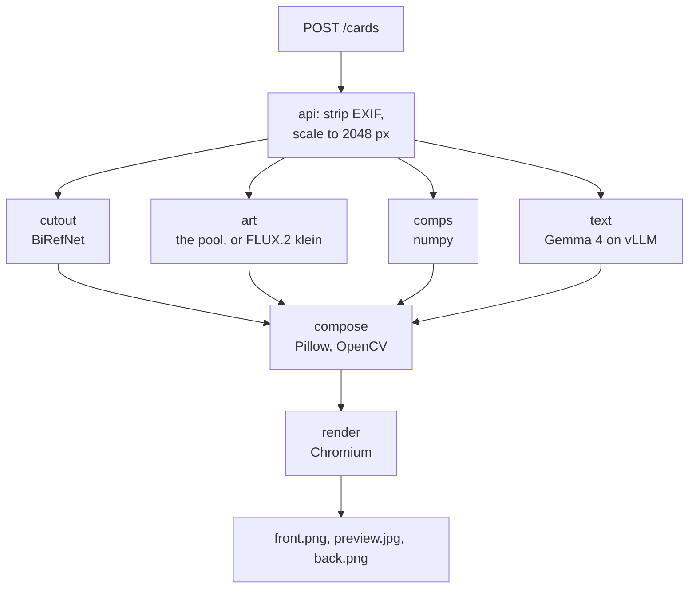

# baseball-card

You give it a headshot and a name. Three open-weight models on one Akamai Cloud
GPU node make you a baseball card, front and back. Nothing leaves the node.

**$300 in free credit for Akamai Cloud.**
[Sign up here](http://login.linode.com/signup?promo=akm-dev-git-300-72326-P153).
At 0.67 USD an hour, that is about 440 hours of the default node.

<p>
  
  
</p>

A card made by these three models on an Akamai Cloud GPU node.

BiRefNet cuts you out of the photo. FLUX.2 [klein] paints the stadium. Gemma 4
writes the nickname and the scouting report from the facts you gave. The back
of the card names the model behind each step, its licence, the GPU it ran on
and the milliseconds it took.

| Step | Model | Licence | VRAM |
|---|---|---|---|
| cutout | [`ZhengPeng7/BiRefNet`](https://huggingface.co/ZhengPeng7/BiRefNet) | MIT | 2,012 MiB |
| art | [`black-forest-labs/FLUX.2-klein-4B`](https://huggingface.co/black-forest-labs/FLUX.2-klein-4B) | Apache 2.0 | 986 MiB idle, weights in RAM |
| text | [`google/gemma-4-12B-it-qat-w4a16-ct`](https://huggingface.co/google/gemma-4-12B-it-qat-w4a16-ct) on vLLM | Apache 2.0 | 13,500 MiB |
| comps | nearest neighbour in numpy over 225 Statcast hitters | n/a | none |

VRAM is `nvidia-smi` per process on the default one-card node on 2026-11-07,
16,518 of 20,475 MiB in all. `deploy/models.env` pins each model to a commit.

## status

The first node ran on 2026-11-07: a `g2-gpu-rtx4000a1-m` in us-ord, one card
shared by the three models. `make check` passed, and `make smoke` made a
card in 7.5 seconds. The two-card layout was measured on an earlier deployment of the
same models, and has not run from this repo.
[docs/ARCHITECTURE.md](docs/ARCHITECTURE.md) has the numbers for both.

## prerequisites

1. An Akamai Cloud account, and a personal access token that can read and
   write Linodes and Firewalls.
2. `terraform` 1.7 or newer.
3. [`uv`](https://docs.astral.sh/uv/).
4. `make`, `ssh`, `rsync`, `curl`, `jq` and `openssl`.

Docker runs on the node, not on your machine.

## deploy

```bash
export LINODE_TOKEN=...   # in your shell, never in .env
make env                  # writes .env with a new CARD_API_KEY
```

Set `ALLOW_CLOUD_DEPLOY=1` in `.env`. Then:

```bash
make gpu-check    # which regions can sell the plan right now. Reads, changes nothing
make deploy       # the node, its firewall, the driver, the weights, the stack
make tunnel       # localhost:8443 is the node while this runs
make check        # the key is enforced, and the models hold their GPUs
make smoke        # a card made on the node, checked to have run on its GPUs
make destroy      # deletes everything tagged baseball-card
```

| `GPU_COUNT` | Plan | GPUs | RAM | USD an hour |
|---|---|---|---|---|
| 1, the default | `g2-gpu-rtx4000a1-m` | 1x RTX 4000 Ada, 20 GB | 32 GB | 0.67 |
| 2 | `g2-gpu-rtx4000a2-s` | 2x RTX 4000 Ada, 20 GB | 32 GB | 1.05 |

The node bills by the hour from `make deploy` until `make destroy`. Prices are
from the Linode API on 2026-11-06. With two cards, FLUX gets one to itself.
The firewall admits SSH from the machine that ran the deploy and from any
address you add to `ADMIN_CIDR` in `.env`. [docs/DEPLOY.md](docs/DEPLOY.md)
walks each step, what to do when one fails, rotating the key, and domain mode,
which serves the gateway at your hostname with a Let's Encrypt certificate.

## use it

Open http://localhost:8443 while `make tunnel` runs and paste the key:

```bash
sed -n 's/^CARD_API_KEY=//p' .env
```

Give it a photo or use the camera, add a name and the numbers you have, pick a
style, and press Generate. The front arrives first and the back a moment
later, beside the ledger. Save front and Save back write PNGs at 1500 x 2100.
The camera finds your face in the browser with BlazeFace and takes the photo
once you are centred, lit, sharp and still. The page keeps the key in the
tab's `sessionStorage` and loads nothing from any other site.

From the command line:

```bash
make card PHOTO=me.jpg STATS=examples/stats.json STYLE=classic
```

The stats file needs a `name`. Number, position, bats, throws, height, weight,
hometown and six swing metrics are optional.
[examples/curl.md](examples/curl.md) lists each field with its range and calls
every route once.

## the api

`/livez` answers without the key. Every other route wants
`Authorization: Bearer $CARD_API_KEY`. A bad post gets a 400 and a sentence:
`The number is 120. It has to be from 0 to 99.` A model service that is down
does not stop a card. The card comes out without that step, and its warnings
say which. Cards and photos stay for `RETENTION_HOURS`, 24 by default, or
until `DELETE /cards/{id}`. vLLM is the stock OpenAI-compatible server behind
the same key, and `uv run examples/openai_sdk.py` streams an answer from it.

## how it works

One node, one gateway, one key. Caddy is the only open port, and the api calls
the three model services over the compose network.

```
laptop
  |  ssh -L 8443:127.0.0.1:8443 (make tunnel), or https://DOMAIN in domain mode
  v
+--------------------------------------------------------------------------+
| g2-gpu-rtx4000a1-m  1x RTX 4000 Ada 20 GB, 32 GB RAM  0.67 USD/h default |
| g2-gpu-rtx4000a2-s  2x RTX 4000 Ada 20 GB, 32 GB RAM  1.05 USD/h         |
|                                                                          |
| caddy  127.0.0.1:8443, or :80 and :443 in domain mode. The only port.    |
|   / /app/* /vendor/* /livez       -> api        :8080  open              |
|   /cards* /healthz /models        -> api        :8080  CPU               |
|   /cutout                         -> cutout     :8001  BiRefNet          |
|   /art/generate                   -> art        :8002  FLUX.2 klein      |
|   /v1/*                           -> llm        :8000  Gemma 4 on vLLM   |
|   /gpu                            -> gpu-stats  :8003  nvidia-smi        |
|                                                                          |
| volumes  card-data   SQLite, the photos and the cards, 24 hours each     |
|          hf-cache    the three models' weights                           |
|          art-data    the pool: six stadiums, nothing about anyone        |
|          caddy-data  the TLS certificate, in domain mode                 |
+--------------------------------------------------------------------------+
```

A card is one POST. Four steps run at once, then two more in order:



The cutout goes onto the art, and Chromium draws both sides from HTML. The art
service keeps three backgrounds per style painted ahead, so no card waits for
FLUX. A style is a front template, a palette and a prompt. `akamai` is a navy
frame with the Akamai logo over a stadium at night. `classic` is a cream
border over a ballpark by day. [docs/ARCHITECTURE.md](docs/ARCHITECTURE.md)
has what a failed step costs the card, the card's rules, and the two GPU
layouts with their VRAM.

## security

One key guards every route but `/livez` and the page that asks for the key.
Caddy is the only service with a port, bound to `127.0.0.1`. The firewall
admits SSH from the addresses you name and nothing else. Nothing leaves the
node: no photo, no stats, no usage report from vLLM.
[docs/SECURITY.md](docs/SECURITY.md) pairs each claim with the command that
checks it.

## layout

```
Makefile              every command. make help lists them
docker-compose.yml    the stack. Profile gpu on the node, mock for the tests
Caddyfile             the gateway, tunnel mode and domain mode
packages/             common: settings and the key check. card: the templates and
                      the renderer. comps: the Statcast hitters and the lookup
services/             api, cutout, art, gpu-stats, and llm-mock for the tests
web/app/              the browser app
cli/                  cardctl
deploy/               models.env, the GPU layouts, terraform, cloud-init, the scripts
docs/                 the architecture, the deploy and the security claims
examples/             the test player's numbers, every route with curl, the OpenAI SDK
tests/                unit, integration, security, and the test photo
```

[CONTRIBUTING.md](CONTRIBUTING.md) covers the tests, the lint, the writing
rules, the pictures, and the mock stack the tests run on, which also runs the
app on a machine with no GPU.

## licence

Apache-2.0, see [LICENSE](LICENSE). The font is under the SIL Open Font
License, beside it in `packages/card/src/card/fonts/`. The Akamai logo in
`packages/card/src/card/brand/` is Akamai's trademark. The face detector,
MediaPipe Tasks Vision with its BlazeFace model, is Apache-2.0 and downloads
when the api image builds. The test photo is CC0, and
`tests/fixtures/SOURCES.md` says where it came from. The hitters' table in
`packages/comps/src/comps/data/` is public MLB data from Baseball Savant.
