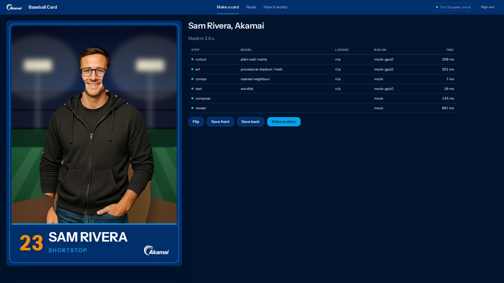

# baseball-card

You give it a headshot and a name. Three open-weight models on one Akamai Cloud
GPU node make you a baseball card, front and back. Nothing is sent to any other
service.

<p>
  
  
</p>

That is the test photo's card, drawn by `make card-fixture` with stand-ins for
the models. The matte is a colour threshold, and it bit into the right cheek.
The stadium is drawn with numpy, and the comps and the words are samples. The
back says so on its last line.

BiRefNet cuts you out of the photo, FLUX.2 [klein] paints a stadium behind you,
and Gemma 4 writes your nickname and a scouting report from the facts you gave.
The back of the card lists which model ran each step, under which licence, on
which GPU, in how many milliseconds.

## what has run, and where

This repo was built and tested on one Linux box with 16 cores, Docker and no
GPU. No node has run it yet.

| Part | Where it has run |
|---|---|
| The gateway, the key, the api, the pipeline, the comps, `cardctl` | the mock stack, through the tests and `make card-mock` |
| The card, both sides, both styles | Chromium on that box, with stand-ins for the models |
| The browser app, the camera and the face detector | Chromium against the mock stack, with a fake camera |
| BiRefNet | for real, on that box's CPU, with `make card-cpu-cutout` |
| FLUX.2 [klein] and Gemma 4 | their code, in tests with the model stubbed. Not run from this repo |
| The two-card layout | its memory, measured on another deployment of the same models and settings |
| The one-card layout | sized on paper. Not run anywhere |
| Terraform, cloud-init and the deploy scripts | against stand-ins for Terraform, SSH and the Linode API, and `terraform test` with a mocked provider |
| `make gpu-check` | against the live Linode API, which it only reads |

## models

| Step | Model | Licence | VRAM | `GPU_COUNT=1` | `GPU_COUNT=2` |
|---|---|---|---|---|---|
| cutout | [`ZhengPeng7/BiRefNet`](https://huggingface.co/ZhengPeng7/BiRefNet) | MIT | 2,012 MiB | card 0 | card 1 |
| art | [`black-forest-labs/FLUX.2-klein-4B`](https://huggingface.co/black-forest-labs/FLUX.2-klein-4B) | Apache 2.0 | 17,956 MiB on a card of its own | card 0, weights in RAM | card 0, alone |
| text | [`google/gemma-4-12B-it-qat-w4a16-ct`](https://huggingface.co/google/gemma-4-12B-it-qat-w4a16-ct) on vLLM | Apache 2.0 | 16,982 MiB at 0.80 of a card | card 0, 0.65 of it | card 1, 0.80 of it |
| comps | nearest neighbour in numpy, over 225 Statcast hitters | n/a | none | CPU | CPU |

`deploy/models.env` pins each one to a commit. Both layouts serve the same
three models.

The VRAM column is `nvidia-smi` per process on a `g2-gpu-rtx4000a2-s` node
running these models with the two-card settings: FLUX in September 2026, the
other two on 2026-10-30. That was another deployment of the same three
models, not this repo. The one-card layout has not run anywhere: it is sized on
paper. There, FLUX keeps its 16 GB of weights in the node's RAM and copies each
layer to the card as it paints, under 3,000 MiB of the card at a time, and
slower by an amount not measured yet. Gemma 4 12B and BiRefNet take the rest.
[docs/ARCHITECTURE.md](docs/ARCHITECTURE.md) has the sums.

| `GPU_COUNT` | Plan | GPUs | RAM | USD an hour |
|---|---|---|---|---|
| 1, the default | `g2-gpu-rtx4000a1-m` | 1x RTX 4000 Ada, 20 GB | 32 GB | 0.67 |
| 2 | `g2-gpu-rtx4000a2-s` | 2x RTX 4000 Ada, 20 GB | 32 GB | 1.05 |

Prices from the Linode API on 2026-11-06. A node bills by the hour until it is
deleted.

## quick start

Mock mode runs every service in Docker with stand-ins for the models. No GPU,
no cloud account. It needs Docker with Compose 2.24 or newer, `make`, `curl`,
`openssl` and [`uv`](https://docs.astral.sh/uv/).

```bash
git clone https://github.com/akamai-developers/demo--baseball-card.git
cd demo--baseball-card
make up-mock      # writes .env with a new key, builds, serves localhost:8443
make card-mock    # the test photo's card, through the stack, into out/
```

If your user needs `sudo` for Docker, say so once per command:
`DOCKER="sudo -E docker" make up-mock`. If port 8443 is taken, set
`GATEWAY_PORT` in `.env`. The first `make up-mock` builds five images and
downloads the browser's 12 MB face detector, which takes a few minutes. After
that it takes seconds.

`make card-mock` posts `tests/fixtures/portrait.jpg` and `examples/stats.json`
to the stack, waits for the card, and prints the ledger:

```
step     model                           licence  ran on     ms   status
-------  ------------------------------  -------  ---------  ---  ------
cutout   mock/plain-wall-matte           n/a      mock-gpu0  271  done
art      mock/procedural-stadium · pool  n/a      mock-gpu0  68   done
comps    nearest neighbour               n/a      mock       13   done
text     mock/wordlist                   n/a      mock-gpu0  25   done
compose  -                               -        mock       185  done
render   -                               -        mock       993  done

out/card-front.png
out/card-back.png
out/card-preview.jpg
out/card.json

2.2s total
```

That was on the 16-core box this repo was built on. Every model here is a
stand-in, and each one says so in the model column: `mock/plain-wall-matte` is
a colour threshold, `mock/procedural-stadium` draws a ballpark with numpy, and
`mock/wordlist` picks words from lists. The comps are real: the three 2025
hitters whose Statcast numbers sit nearest yours.

`pool` on the art row means the art service painted that background before the
card asked. It keeps three per style painted ahead, `ART_POOL_SIZE`, and paints
another when the model is free. On the node that is what keeps a card from
waiting for FLUX. A card that finds none ready gets one painted for it, and the
row says `fresh`.

## the app

Open http://localhost:8443 and paste the key. `make up-mock` wrote it into
`.env`, and this prints it:

```bash
sed -n 's/^CARD_API_KEY=//p' .env
```



Give it a photo from a file or the camera, a name, the numbers you have and a
style, then Generate. The front comes in first and the back a moment later,
beside the ledger of every step. A click turns the card over. Save front and
Save back write the PNGs at 1500 x 2100. Make another brings the form back as
you left it. Node shows what each service says about itself and what each GPU
is doing. How it works is the pipeline in five lines and the model table, all
read from the api.

The Camera tab draws a guide and takes the photo once your face is centred,
lit, sharp and still for 1.5 s. The browser only allows a camera on
`localhost` or HTTPS, so it works on the mock stack and through an SSH tunnel.
Your face is found in the browser by BlazeFace, which the api image downloads
from the pins in `web/vendor.lock` and serves from `/vendor/`. Without it the
camera still works, the guide is off, and the card places you by the top of
your outline.

The page keeps the key in the tab's `sessionStorage` until you sign out or
close the tab. It asks nothing of any other site: no CDN, no fonts from
elsewhere, no analytics.

## your own card

```bash
uv run cardctl make --photo me.jpg --stats examples/stats.json --out out/
uv run cardctl make --photo me.jpg --stats examples/stats.json --style classic
make card PHOTO=me.jpg STATS=examples/stats.json STYLE=classic OUT=out
```

In mock mode use a photo against a plain wall, waist up. The stand-in for
BiRefNet keys out the wall by its colour and cannot cut a busy background.
`cardctl` reads the key from `CARD_API_KEY` in your environment or from `.env`.
It has no flag for the key, so the key never lands in your shell history.

The stats file needs a `name`. Everything else is optional: `number` (0 to 99),
`position` (`SS`, `CF`, up to 4 characters), `bats` (`R`, `L` or `S`),
`throws` (`R` or `L`), `height_in`, `weight_lb`, `hometown`, and up to six
numbers in `metrics`:

| Key | On the card | Range |
|---|---|---|
| `bat_speed_mph` | Bat Speed | 50 to 85 mph |
| `exit_velo_mph` | Exit Velocity | 60 to 115 mph |
| `launch_angle_deg` | Launch Angle | -10 to 35 deg |
| `swing_length_ft` | Swing Length | 4.5 to 10 ft |
| `attack_angle_deg` | Attack Angle | -5 to 25 deg |
| `time_to_contact_ms` | Time to Contact | 100 to 220 ms |

A card with no numbers has no stats table and no "Swings like". A number out of
its range is refused with a sentence that says the range.

Cutout, art, comps and text run at the same time. Then the cutout goes onto the
art, and Chromium draws both sides. The front is written first, so a caller
polling `GET /cards/{id}` can show it while the back is still drawing.

## BiRefNet on your CPU

BiRefNet is the one real model a laptop can run. This builds the cutout service
on CPU torch, puts it in the mock stack in place of the matte, and makes a card:

```bash
make card-cpu-cutout                  # the test photo
make card-cpu-cutout PHOTO=me.jpg     # yours, on any background
```

The first run builds a 1.8 GB torch image and downloads 444 MB of weights into
the `hf-cache` volume. On the 16-core box this repo was built on, a photo then
takes 15 to 25 seconds. The ledger says `ZhengPeng7/BiRefNet` on `local-cpu`,
and the back of the card says no GPU was used. `make up-mock` puts the matte
back.

## on Akamai Cloud

Six commands, from your machine, with `LINODE_TOKEN` in your shell and
`ALLOW_CLOUD_DEPLOY=1` in `.env`:

```bash
make gpu-check    # which regions can sell the plan right now. Reads, changes nothing
make deploy       # the node, its firewall, the driver, the weights, the stack
make tunnel       # localhost:8443 is the node while this runs
make check        # the key is enforced, and the models hold their GPUs
make smoke        # a card made on the node, checked to have run on its GPUs
make destroy      # deletes everything tagged baseball-card
```

The node bills by the hour until `make destroy`: 0.67 USD with `GPU_COUNT=1`,
1.05 with `GPU_COUNT=2`. In the default tunnel mode only SSH is open, from
your address alone. [docs/DEPLOY.md](docs/DEPLOY.md) goes through each step,
then calling vLLM yourself with curl and the OpenAI SDK, rotating the key, and
domain mode, which puts the gateway on the internet with a Let's Encrypt
certificate.

None of this has run against a real node from this repo yet. The scripts ran
here against stand-ins for Terraform, SSH and the Linode API. `make gpu-check`
ran against the live API on 2026-11-06 at 22:28 UTC, when six regions could
sell both plans. Earlier that day none could.

## the api

`/livez` is the one route open without the key:

```bash
curl -s -w '\n' http://localhost:8443/livez                               # ok
curl -s -o /dev/null -w '%{http_code}\n' http://localhost:8443/healthz   # 401
```

Everything else wants the key from `.env`:

```bash
export CARD_API_KEY=$(grep '^CARD_API_KEY=' .env | cut -d= -f2)
curl -s -w '\n' -H "Authorization: Bearer $CARD_API_KEY" http://localhost:8443/healthz
```

`/healthz` lists each model service as it describes itself.
[examples/curl.md](examples/curl.md) calls every route once: make a card, read
it, fetch both sides, delete it, and call each model on its own.

A post the api cannot use is a 400 whose `detail` says what to change, such as
`The number is 120. It has to be from 0 to 99.` A model service that is down
does not stop a card: the card comes out without that model, and its warnings
say which service and where its log is.

A card and its photo stay on the data volume for `RETENTION_HOURS`, 24 by
default. `DELETE /cards/{id}` removes them at once.

```bash
make test         # unit tests, and the integration tests against the stack
make down         # stop the stack. The volumes stay
make help         # every target
```

## the card

`make card-fixture` draws the test photo's card into `out/` with no stack and
no models: `card-front.png` and `card-back.png`, 1500 x 2100 each, and a
500 x 700 preview of the front. Playwright's Chromium draws both sides, and
the first run downloads it into Playwright's cache.

```bash
make card-fixture                  # the akamai style
make card-fixture STYLE=classic    # the classic style
```

On Linux, Chromium needs a few system libraries. If it will not start,
`uv run playwright install-deps chromium` installs them, with `sudo`.

A style is a front template, a palette and a prompt. `akamai` is a navy frame
with the Akamai logo, over a stadium at night. `classic` is a plain cream
border with no logo, over a ballpark by day. Each one is
`packages/card/src/card/templates/front-<style>.html` and an entry in
`styles.json`, which holds its colours and the prompt FLUX paints its
background from. The back is one template in the style's colours.

The face decides where you stand. Your face is 14 percent of the picture's
height, centred 27 percent of the way down, and you stand on the name plate.
A photo cut off at the waist makes the face bigger, up to 30 percent, so you
still reach the plate. The top edge never cuts your head. The image models
write no words on the card: every word is HTML.

The back has your bio, the nickname, the numbers you gave, the three hitters
nearest them, the scouting report and the ledger. The ledger names each
step's model, licence, where it ran and how many milliseconds it took. The
last line says "Made on Akamai Cloud GPUs" only when every model step ran on
a GPU.

## security

One key guards every route but `/livez` and the app's own page and files,
which is where the key is typed. Caddy is the only service with a port, and it
binds `127.0.0.1`. On the node the firewall lets in SSH from your address and
nothing else, and `make tunnel` is the way to the gateway. Nothing leaves the
node: no photo, no stats, and not vLLM's usage report.
[docs/SECURITY.md](docs/SECURITY.md) lists each claim with a command that
checks it.

## layout

```
Makefile              every command here
docker-compose.yml    profiles mock and gpu
Caddyfile             the gateway, tunnel mode and domain mode
packages/common/      settings, the key check, schemas
packages/card/        the face rule, the compositor, the templates, the renderer
packages/comps/       the Statcast hitters and the nearest-neighbour lookup
services/api/         the orchestrator: routes, pipeline, text, photo checks
services/cutout/      the person out of the photo: BiRefNet, or the matte
services/art/         the stadium behind them: FLUX.2 klein, or a drawing
services/gpu-stats/   nvidia-smi as JSON
services/llm-mock/    vLLM's routes without vLLM
services/vision-base.Dockerfile   torch, under the real cutout and art images
web/app/              the browser app: the page, its scripts, its font and logo
web/vendor.lock       the face detector's files, pinned by sha256
cli/                  cardctl
deploy/models.env     the model repos and their pinned commits
deploy/layouts/       which card each model is on, for one GPU and for two
deploy/terraform/     the instance and its firewall, and their tests
deploy/cloud-init/    the driver, Docker and the hardened sshd, on first boot
deploy/scripts/       gpu-check, deploy, tunnel, check, smoke, rotate-key, destroy
docs/                 the architecture, the deploy and the security claims
examples/             the test player's numbers, every route with curl, the OpenAI SDK
tests/                unit, integration, security, and the test photo
```

## licence

Apache-2.0. See [LICENSE](LICENSE). Two files in the card are not covered by
it: the font is under the SIL Open Font License, beside it in
`packages/card/src/card/fonts/`, and the Akamai logo in
`packages/card/src/card/brand/` is Akamai's trademark. The app uses copies of
the same two files, in `web/app/fonts/` and `web/app/brand/`. The face
detector, MediaPipe Tasks Vision and its BlazeFace model, is Apache-2.0. It is
downloaded when the api image is built and is not in this repo. The test photo is CC0,
and `tests/fixtures/SOURCES.md` says where it came from. The hitters' table in
`packages/comps/src/comps/data/` is public MLB data from Baseball Savant, used
only to compare one set of numbers to another. Its first lines say where each
column came from.
