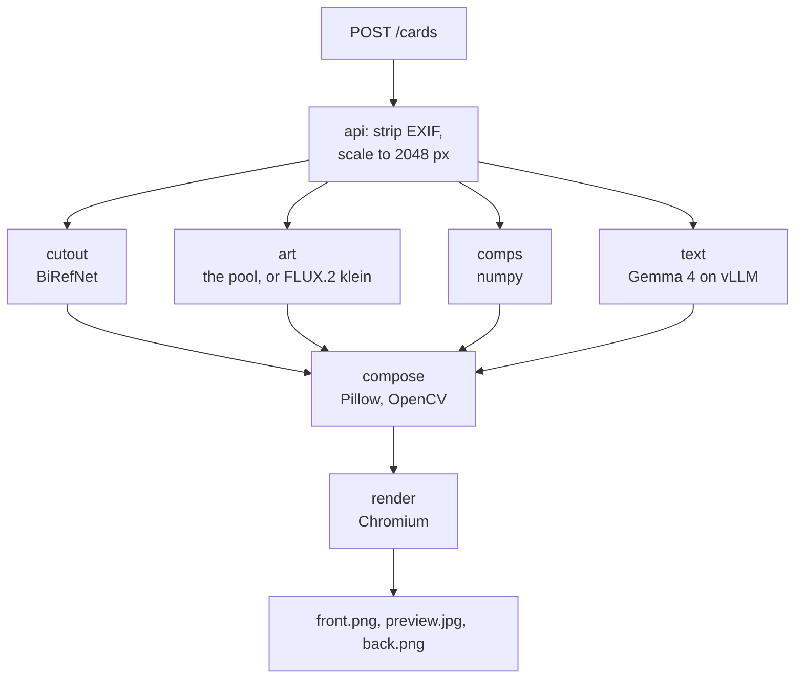

# Architecture

One GPU node on Akamai Cloud runs six containers behind one gateway and one
API key. A laptop runs the same six with stand-ins for the three models.

## the node

```
laptop
  |  ssh -L 8443:127.0.0.1:8443 (make tunnel), or https://DOMAIN in domain mode
  v
+--------------------------------------------------------------------------+
| g2-gpu-rtx4000a1-m  1x RTX 4000 Ada 20 GB, 32 GB RAM  0.67 USD/h  default |
| g2-gpu-rtx4000a2-s  2x RTX 4000 Ada 20 GB, 32 GB RAM  1.05 USD/h          |
|                                                                          |
| caddy  127.0.0.1:8443, or :80 and :443 in domain mode. The only port.    |
|   / /app/* /vendor/* /livez       -> api        :8080  open              |
|   /cards* /healthz /models        -> api        :8080  CPU               |
|   /cutout                         -> cutout     :8001  BiRefNet          |
|   /art/generate                   -> art        :8002  FLUX.2 klein      |
|   /v1/*                           -> llm        :8000  Gemma 4 on vLLM   |
|   /gpu                            -> gpu-stats  :8003  nvidia-smi        |
|                                                                          |
| volumes  card-data   SQLite, the photos and the cards, 24 hours each     |
|          hf-cache    the three models' weights                           |
|          art-data    the pool: six stadiums, nothing about anyone        |
|          caddy-data  the TLS certificate, in domain mode                 |
+--------------------------------------------------------------------------+
```

Every route but `/livez` and the page's own files needs
`Authorization: Bearer $CARD_API_KEY`. vLLM checks it itself, as
`VLLM_API_KEY`. The other four services check it with
`packages/common/src/common/auth.py`, and the api sends it when it calls them.

## one card



Cutout, art, comps and text start together. BiRefNet and FLUX answer with
`X-Model`, `X-License`, `X-Ran-On` and `X-Infer-Ms`, and the ledger on the back
of the card copies them. vLLM sends none: the text row comes from the node's
`.env`: the pins in `deploy/models.env` and the GPU layout's `LLM_RAN_ON`.

- **cutout.** BiRefNet at 1024 x 1024, fp16. `card.matte.refine_matte` fills
  the holes it leaves inside the person and drops the specks outside. The
  matte also says how the photo was framed: cut off, small, no subject.
- **art.** A card asks for its style's recipe from `card/backgrounds.py`, the
  same picture every card in that style asks for. The art service keeps
  `ART_POOL_SIZE` of them per style painted ahead, 3 by default, on
  `art-data`, and a card takes one at once. The painter paints a replacement
  when the model has been free for a second, and gives way to a request at the
  end of the step it is on.
- **comps.** numpy, z-scored nearest neighbour over 225 Statcast hitters. Only
  when numbers were given.
- **text.** Gemma 4 writes a nickname, a tagline and two to four sentences from
  the facts, as JSON to a schema. `check()` in `services/api/src/api/text.py`
  refuses a number the person did not type. One retry, then a template.
- **compose.** The face box from the browser, or the top of the silhouette,
  decides the person's size and place. A ground shadow, and the edge given the
  colour of the person inside it.
- **render.** Both sides at once in one Chromium that stays up. The front is
  written first, so the app shows it while the back is drawn.

| Step fails | Card gets |
|---|---|
| cutout | the art alone |
| art | a stadium drawn with numpy, and the ledger says so |
| comps | no "Swings like" |
| text | the template |
| compose, render | no card. The job fails |

## the two GPU layouts

`GPU_COUNT` in `.env` picks the plan and the layout. A layout is six lines,
`deploy/layouts/gpu1.env` or `gpu2.env`, that go into the node's `.env`.
`docker-compose.yml` reads them, and its defaults are the one-GPU layout.

| | GPU_COUNT=1 | GPU_COUNT=2 |
|---|---|---|
| plan | g2-gpu-rtx4000a1-m | g2-gpu-rtx4000a2-s |
| FLUX.2 klein | card 0, weights in RAM, a layer at a time | card 0, alone |
| BiRefNet | card 0 | card 1 |
| Gemma 4 on vLLM | card 0, 0.65 of it | card 1, 0.80 of it |
| measured | no, sized on paper | yes, September and October 2026 |

An RTX 4000 Ada has 20,475 MiB. With two cards, `nvidia-smi` per process with
these models and settings, card 0 in September 2026 and card 1 on 2026-10-30:

```
card 0  FLUX.2 klein   17,956 MiB   painting backgrounds
card 1  Gemma 4 12B    16,982 MiB   0.80 of the card is 16,380, plus 602
        BiRefNet        2,012 MiB
        spare           1,466 MiB
```

With one card, on paper:

```
card 0  Gemma 4 12B    13,911 MiB   0.65 of the card is 13,309, plus 602
        BiRefNet        2,012 MiB
        FLUX.2 klein   under 3,000 MiB, its weights in RAM
        spare          about 1,550 MiB
```

Gemma's weights are 9,789 MiB, so vLLM cannot go much lower. FLUX is the one
that gives. Moved to the card one part at a time, its transformer is 7,392 MiB
at once, and FLUX peaks at about 10,284 MiB: the 17,956 measured, less the text
encoder, which is off the card while the transformer runs. Beside BiRefNet that
leaves vLLM 8,179 MiB, less than Gemma's weights alone. So with
`ART_CPU_OFFLOAD=1` the art service copies each layer to the card as it runs,
and every painting copies the 16 GB of weights across again. That is slower,
by an amount not measured yet, and the pool is what keeps a card from waiting
for it. The 16 GB of weights live in RAM, which is why the default plan has
32 GB and not the 16 GB of `g2-gpu-rtx4000a1-s`.

`tests/unit/test_compose_gpu.py` renders the gpu profile with each layout and
checks which card each model is on, the label it reports, and these sums.

## two profiles

| | mock | gpu |
|---|---|---|
| cutout | a colour key on a plain wall, or BiRefNet on the CPU with `make up-cpu-cutout` | BiRefNet, fp16 |
| art | a drawn ballpark, with the same pool | FLUX.2 [klein] 4B, bf16, 4 steps |
| llm | a word list behind vLLM's two routes | vLLM, Gemma 4 12B w4a16 |
| gpu-stats | one invented card | `nvidia-smi` |
| labels | `mock-gpu0` | `akamai-gpu0`, `akamai-gpu1` |

The api and Caddy are the same in both. The gpu profile's model services carry
a network alias to the mock's name, so the Caddyfile and the api call `cutout`,
`art` and `llm` either way.

## the images

| Image | Built from | Size |
|---|---|---|
| api | `python:3.12-slim`, the lock, Chromium | 2.9 GB |
| cutout, art, llm, gpu-stats, mock | `python:3.12-slim`, the lock | 360 to 590 MB |
| vision base | `nvidia/cuda:12.6.3-runtime-ubuntu24.04`, torch 2.14.0 from the cu126 index | 15 GB, built on the node |
| cutout, art, gpu | the vision base, then the lock with the `real` extra | 0.5 GB more each |
| llm, gpu | `vllm/vllm-openai:v0.29.0` as published | 9 GB to download |

Every image but vLLM installs from `uv.lock` with `uv sync --frozen`. The real
cutout and art images keep the base's CUDA torch and take everything else from
the lock. BiRefNet runs on transformers 4 and FLUX's text encoder on
transformers 5, so the two `real` extras are declared as conflicting, and the
lock holds both.

On 2026-11-06 the vision base and both real images were built on a machine with
no GPU. Inside them torch was `2.14.0+cu126`, with transformers 4.57.6 beside
BiRefNet and 5.17.0 and diffusers 0.40.0 beside FLUX. They have not run on a
GPU yet.
